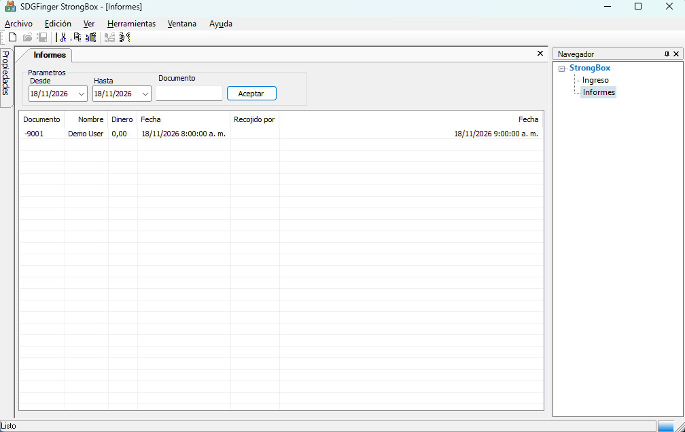
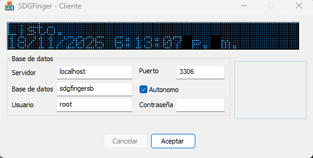
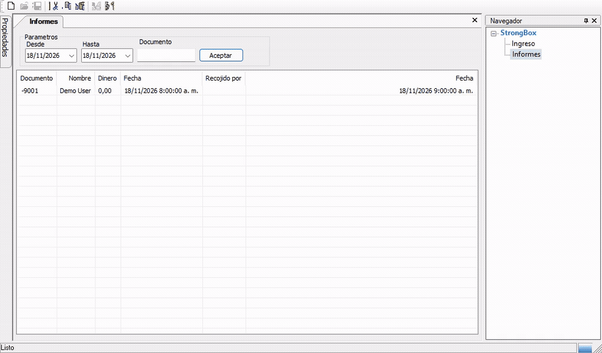
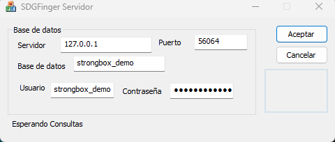

# StrongBox

[English](#english) · [Español](#español)

## English

Legacy Windows suite for managing fingerprint enrollment and access records

> [!WARNING]
> **Status: Legacy.** The July 2006 snapshot builds for Win32 with MSVC v145 after the 2026 compatibility changes.

### Overview

StrongBox contains a Windows administration tool, a server that processes lookup requests, and a client that uses a reader at an access point. The recovered Visual C++ solution dates to July 2006.

### Features

- In the administration tool, manage users and their groups, select a database, and open access reports.
- On the server, configure the database and process pending fingerprint lookups.
- At the client, configure the reader workflow and display the lookup result.

### Requirements

The July 2006 library revisions could not be recovered. This build adapts the original StrongBox code to the 2009 `libreria1` APIs listed below. The converted projects use the shared `Componentes` copies of the bitmap, splash, MDI tabs, status bar, tray icon and display controls. The corresponding application sources are retained as archived.

Visual Studio Community 2026 18.11.4 with Desktop development with C++, x86 MSVC v145, MFC and the Windows SDK 10.0.26100.0. The trial ran on Windows 11 Pro. It uses the x86 GrFinger 4.2 SDK, InpOut32 1.0.0.1 and the MySQL 5.0.16 client SDK. `ThemeSdkDir` points to the directory containing `tmschema.h` from the Microsoft Platform SDK for Windows Server 2003 SP1. The SDKs remain external.

The included source comes from `libreria1`. The dates and versions below identify the DLLs archived next to that source. The 2026 reconstruction adapts those sources for the older application and the newer compiler.

| Library | Archived DLL version | Build date |
| --- | --- | --- |
| Componentes | 2.1.0.1 | 2009-04-03 |
| Conector | 3.0.0.1 | 2009-04-03 |
| IOFile | 2.0.1.1 | 2009-04-03 |
| LAppc | 1.1.0.1 | 2009-03-30 |
| JPrint | 1.0.0.1 | 2009-04-03 |
| JLang | 1.0.0.1 | 2009-04-03 |
| Hhelp | 1.0.0.1 | 2009-04-03 |

### Getting started

Application serial checks are disabled by default. The original checks are compiled only with `ENABLE_LICENSE_CHECK`. Device use still requires a licensed GrFinger runtime.

Set `GrFingerSdkDir` to the directory containing `GrFinger.h` and `GrFinger.lib` and `InpOut32SdkDir` to the directory containing `inpout32.lib`. Ask Griaule for the licensed legacy x86 SDK. Set `MySqlSdkDir` to a directory containing `libmysql.lib` and `include/mysql.h`, and `ThemeSdkDir` to the directory with the legacy theme header. Keep all four directories outside this repository. Open an x86 developer prompt and run:

```bat
MSBuild.exe StrongBox.sln /t:Build /m:4 /p:Configuration=Release /p:Platform=Win32 /p:PlatformToolset=v145 /p:PreferredToolArchitecture=x64 /nologo
```

Ask the vendor for the exact legacy SDK 4.2 before buying or installing a current package. [Griaule SDK support](https://docs.griaule.com/sdks/en)

Obtain the x86 MySQL 5.0 client headers and import library from a matching vendor package. [MySQL product archive](https://downloads.mysql.com/archives/?p=mysql-5.0)

For a physical LCD, check the supported systems and x86 packages before installing the driver. [InpOut32 project downloads](https://www.highrez.co.uk/downloads/inpout32/)

From the Windows Server 2003 SP1 Platform SDK ISO, extract the `Tmschema_h.*`
entry from `Setup/PSDK-SDK_Core_BLD-common.1.cab` and name it `tmschema.h`.
Point `ThemeSdkDir` to that extracted directory. [Microsoft Download Center](https://www.microsoft.com/en-us/download/details.aspx?id=15656)

### Running the applications

The solution places the administration tool (`SDGFingerSB.exe`), lookup server
(`SDGFingerServidor.exe`), checkpoint client (`SDGFingerCliente.exe`), and the
seven rebuilt library DLLs in `bin/Release`. Put the matching x86 `libmysql.dll`
next to the applications. Install the x86 Microsoft Visual C++ runtime on any
machine that does not already have it.

1. Load [the example schema](demo/schema-demo.sql) into an isolated database.
   It creates one fictional access record. Use [the example connection settings](demo/config.example.ini)
   as a reference. Supply a test MySQL account and password for that instance.
2. Open `SDGFingerSB.exe --without-reader`. Use **Bases de Datos** to add the
   database, then enter the account in **Ingreso**. For the historical login,
   the schema must contain a `shared` record for that account with `nReservado = 2`
   and `szReservado` different from `-1`. Use **Informes** to query access records
   for the selected dates, with an optional document number. Use the date
   described in the sample report below.
3. Open `SDGFingerCliente.exe --without-reader` to check the checkpoint dialog
   without starting fingerprint capture. Use **Salir** from the tray menu to
   exit. To read fingerprints, install a licensed x86 GrFinger 4.2 runtime
   and compatible reader and start without the option. The optional parallel-port
   LCD also needs the matching `InpOut32.dll` and a compatible installed driver.
   Enable it only on that hardware by setting `control/lcd` in the client profile.

Source builds store the three applications' settings under `Software\StrongBox`
in the current user's registry.

### Application activation

The 2026 reconstruction runs each StrongBox executable without a StrongBox
serial, activation or trial period. The original checks are retained under
`ENABLE_LICENSE_CHECK`, which is undefined in the supplied projects. The server
can run from a clean build without `appt.dll`. MySQL still authenticates the
configured database account. Fingerprint operations use the licensed GrFinger SDK.

To open the lookup server against the disposable demo, configure its database
using the settings in `demo/config.example.ini` and use
`SDGFingerServidor.exe --without-reader` with an empty `busqueda` queue. The option
skips SDK initialization and is intended for the empty-queue test.

The x86 MySQL 5.0.16 client used in this reconstruction relies on native password
authentication. The verification used MySQL 8.4.13 configured for that plugin
in a disposable instance bound to loopback. [MySQL 8.4 authentication documentation](https://dev.mysql.com/doc/refman/8.4/en/native-pluggable-authentication.html)

### Sample report

The Win32 test opens the administrator and checkpoint client, checks the administrator’s report with a fictional access record, and verifies that the server can read an empty MySQL queue. The result is partial. Live fingerprint enrollment and matching require a compatible reader, and physical output requires a parallel-port LCD.

The example schema starts with a fictional access dated July 21, 2006. The verification commands below move it to the day of the test. In the screenshot and GIF, both date fields are set to November 18, 2026, the date of the recorded demonstration.

### Project structure

| Path | Contents |
| --- | --- |
| `src/SVE/` | Administration, user management, and access reports |
| `src/SVEServer/` | Server for queued fingerprint lookups |
| `src/sveclient/` | Checkpoint dialog and optional LCD integration |
| `vendor/` | Recovered libraries and their converted projects |
| `demo/` | Synthetic database schema and connection example |
| `docs/` | Verification media in `docs/media/` |

The three applications share the DLLs built by this solution. Keep them together when running the programs.

### Contributing

This repository is kept for historical reference. This trial is local.

### Support

Build logs for this trial accompany the local audit. For questions about the archive, see the original project's [issue tracker](https://github.com/plaspy-dev/StrongBox/issues).

### History

The archived history records the July 2006 snapshot and two later documentation commits. The 2026 local reconstruction adds the converted projects and the source from the later `libreria1` archive for this experiment.

### Verification

On November 25, 2026, MSBuild 18.11.1.51303 ran the Release Win32 command below
from three separate exports on Windows 11 Pro build 26300 with MSVC
14.51.36231 x86. The local test used `53225b43494c` with the fictional debug preset and trial date. The suite built all three applications and seven libraries. The local
test opened and closed the administration tool and the checkpoint client and
signed in to MySQL 8.4.13 using a fictional account. The **Informes** view
displayed one fictional access record. The server displayed its main dialog
without an activation prompt and polled the empty lookup queue in MySQL. Live
fingerprint enrollment, matching and the physical LCD remain unverified.

```bat
MSBuild.exe StrongBox.sln /t:Build /m:4 /p:Configuration=Release /p:Platform=Win32 /p:PlatformToolset=v145 /p:PreferredToolArchitecture=x64 /nologo /v:minimal
bin\Release\SDGFingerSB.exe --without-reader
bin\Release\SDGFingerCliente.exe --without-reader
bin\Release\SDGFingerServidor.exe --without-reader
```

The administrator displayed one result and exited with code 0. The checkpoint
client displayed its default settings. The test sent `WM_COMMAND` ID `2003` to
close the client and recorded exit code `0x000007d3`. The server opened its connection window, read the empty queue, and exited with code `2` (`IDCANCEL`). The test loaded
the demo schema into MySQL on `127.0.0.1` and changed the synthetic access to
the local verification date (November 25, 2026) to match the default report range. There were
no active demo-user MySQL sessions after the administrator exited.

The following PowerShell 7 commands reproduce the demo database on a fixed
loopback port. Open the administrator with the example connection settings and
enter the `strongbox_demo` user and the generated `$demoPassword`. The second
read-only account is the encoded user name the administration tool tries first.

```powershell
$demoContainer = 'strongbox-demo'
$env:MYSQL_ROOT_PASSWORD = [guid]::NewGuid().ToString('N')
$env:MYSQL_PWD = $env:MYSQL_ROOT_PASSWORD
$demoPassword = [guid]::NewGuid().ToString('N')
docker run -d --rm --name $demoContainer -p 127.0.0.1:33306:3306 -e MYSQL_ROOT_PASSWORD mysql@sha256:a81d043930e51745522bd5c430961cf8286f0a23f0a9a2a6e0108f7ea71b0902 --mysql-native-password=ON

# Run the following after MySQL reports it is ready for TCP connections.
Get-Content -Raw .\demo\schema-demo.sql | docker exec -i -e MYSQL_PWD $demoContainer mysql -uroot -N -B
$nameBytes = [Text.Encoding]::UTF8.GetBytes('strongbox_demo')
$legacyAccount = [Convert]::ToHexString([Security.Cryptography.MD5]::HashData($nameBytes)).ToLowerInvariant().Substring(0, 15)
@"
CREATE USER 'strongbox_demo'@'%' IDENTIFIED WITH mysql_native_password BY '$demoPassword';
CREATE USER '$legacyAccount'@'%' IDENTIFIED WITH mysql_native_password BY '$demoPassword';
GRANT SELECT ON strongbox_demo.* TO 'strongbox_demo'@'%';
GRANT SELECT ON strongbox_demo.* TO '$legacyAccount'@'%';
UPDATE strongbox_demo.sucesos SET fecha=CURDATE() + INTERVAL 8 HOUR, salida=CURDATE() + INTERVAL 9 HOUR WHERE id=9001;
"@ | docker exec -i -e MYSQL_PWD $demoContainer mysql -uroot -N -B
```


After testing, stop the isolated container with `docker stop $demoContainer`
and clear the temporary password variables from the shell.

#### Screenshots

The media below show the tested application windows and report filter. They were captured with fictional data from the November 18 demonstration build. The Release Win32 records refer to the November 25 verification.



The report shows Demo User (document `-9001`) on November 18, 2026.



The checkpoint client displays its database settings and on-screen status.



Enter a fictional document with no access records, then clear it to restore the result.



The server opens directly into its database settings and queue status.

### License

The [MIT License](LICENSE) covers the original StrongBox contributions. See the [third-party notices](THIRD-PARTY-NOTICES.md) for the archived controls.

---

## Español

Conjunto legado para Windows que administra el registro de huellas y los accesos

> [!WARNING]
> **Estado: legado.** La versión de julio de 2006 compila para Win32 con MSVC v145 tras las adaptaciones de 2026.

### Descripción general

StrongBox incluye una herramienta de administración para Windows, un servidor que procesa solicitudes de búsqueda y un cliente que usa un lector en un punto de acceso. La solución de Visual C++ recuperada data de julio de 2006.

### Funciones

- En la herramienta de administración, gestiona usuarios y sus grupos, selecciona una base de datos y abre los informes de acceso.
- En el servidor, configura la base de datos y procesa las búsquedas de huellas pendientes.
- En el cliente, configura el trabajo con el lector y muestra el resultado de la búsqueda.

### Requisitos

No se recuperaron las revisiones de las bibliotecas de julio de 2006. Esta compilación adapta el código propio de StrongBox a las interfaces de `libreria1` de 2009 que aparecen abajo. Los proyectos convertidos usan las implementaciones compartidas de `Componentes` para imágenes, pantalla de inicio, pestañas, barra de estado, icono de bandeja y matriz visual. Se conservan los fuentes archivados de esos controles en las aplicaciones.

Visual Studio Community 2026 18.11.4 con Desarrollo para el escritorio con C++, MSVC v145 para x86, MFC y el SDK de Windows 10.0.26100.0. La prueba se hizo en Windows 11 Pro. Usa el SDK GrFinger 4.2 x86, InpOut32 1.0.0.1 y el SDK cliente MySQL 5.0.16. `ThemeSdkDir` apunta a la carpeta que contiene `tmschema.h` del Microsoft Platform SDK para Windows Server 2003 SP1. Los SDK se mantienen fuera del repositorio.

Los fuentes incluidos proceden de `libreria1`. Las fechas y versiones de la tabla identifican las DLL guardadas junto al código. La reconstrucción de 2026 adapta esos fuentes a la aplicación histórica y al compilador actual.

| Biblioteca | Versión de la DLL archivada | Fecha de compilación |
| --- | --- | --- |
| Componentes | 2.1.0.1 | 2009-04-03 |
| Conector | 3.0.0.1 | 2009-04-03 |
| IOFile | 2.0.1.1 | 2009-04-03 |
| LAppc | 1.1.0.1 | 2009-03-30 |
| JPrint | 1.0.0.1 | 2009-04-03 |
| JLang | 1.0.0.1 | 2009-04-03 |
| Hhelp | 1.0.0.1 | 2009-04-03 |

### Cómo empezar

La comprobación de seriales propios queda deshabilitada por defecto. El código original solo se compila con `ENABLE_LICENSE_CHECK`. El lector requiere un runtime de GrFinger con licencia.

Define `GrFingerSdkDir` con la carpeta que contiene `GrFinger.h` y `GrFinger.lib` e `InpOut32SdkDir` con la que contiene `inpout32.lib`. Solicita a Griaule el SDK legado x86 con licencia. Define `MySqlSdkDir` con la carpeta que contiene `libmysql.lib` e `include/mysql.h`, y `ThemeSdkDir` con la ruta a la cabecera de temas antigua. Conserva las cuatro carpetas fuera del repositorio. Abre un símbolo del sistema para herramientas x86 y ejecuta el comando.

```bat
MSBuild.exe StrongBox.sln /t:Build /m:4 /p:Configuration=Release /p:Platform=Win32 /p:PlatformToolset=v145 /p:PreferredToolArchitecture=x64 /nologo
```

Consulta al proveedor por el SDK legado 4.2 antes de comprar o instalar un paquete actual. [Soporte del SDK de Griaule](https://docs.griaule.com/sdks/en)

Obtén las cabeceras y la biblioteca de importación del cliente MySQL 5.0 x86 del paquete correspondiente del proveedor. [Archivo de productos de MySQL](https://downloads.mysql.com/archives/?p=mysql-5.0)

Para usar el LCD físico, consulta los sistemas compatibles y los paquetes x86 antes de instalar el controlador. [Descargas del proyecto InpOut32](https://www.highrez.co.uk/downloads/inpout32/)

Abre la imagen del Platform SDK de Windows Server 2003 SP1 y extrae la entrada
`Tmschema_h.*` de `Setup/PSDK-SDK_Core_BLD-common.1.cab` con el nombre `tmschema.h`.
Apunta `ThemeSdkDir` a la carpeta que contiene el archivo. [Centro de descargas de Microsoft](https://www.microsoft.com/en-us/download/details.aspx?id=15656)

### Uso de las aplicaciones

La solución genera el administrador (`SDGFingerSB.exe`), el servidor de
búsquedas (`SDGFingerServidor.exe`), el cliente del punto de acceso
(`SDGFingerCliente.exe`) y las siete DLL recompiladas en `bin/Release`.
Coloca `libmysql.dll` x86 de la misma versión junto a los ejecutables. Instala
el runtime de Microsoft Visual C++ x86 en los equipos que no lo tengan.

1. Carga [el esquema de ejemplo](demo/schema-demo.sql) en una base de datos
   aislada. El esquema inserta un acceso ficticio. Usa [la configuración de ejemplo](demo/config.example.ini)
   como referencia y proporciona una cuenta y una contraseña de prueba de esa instancia.
2. Abre `SDGFingerSB.exe --without-reader`. Agrega la base en **Bases de Datos** e
   introduce la cuenta en **Ingreso**. El inicio de sesión histórico requiere un
   registro de esa cuenta en `shared` con `nReservado = 2` y `szReservado` distinto
   de `-1`. En **Informes** puedes consultar accesos por intervalo de fechas y,
   si corresponde, por documento. Usa la fecha que se indica en el ejemplo de informe.
3. Abre `SDGFingerCliente.exe --without-reader` para comprobar la ventana del
   punto de acceso sin iniciar la captura de huellas. Usa **Salir** en el menú
   de la bandeja para cerrar. Para leer huellas, instala el runtime x86 de
   GrFinger 4.2 con licencia y un lector compatible y abre el cliente sin esa
   opción. El LCD de puerto paralelo requiere además `InpOut32.dll` y su
   controlador compatible. Habilítalo únicamente en ese equipo con `control/lcd`
   en el perfil del cliente.

Las compilaciones desde los fuentes guardan los ajustes de los tres
ejecutables en `Software\StrongBox` del registro del usuario actual.

### Activación de la aplicación

La reconstrucción de 2026 ejecuta los tres programas de StrongBox sin serial,
activación ni periodo de prueba propios. La comprobación original queda bajo
`ENABLE_LICENSE_CHECK`, que los proyectos entregados dejan sin definir. El
servidor se puede ejecutar desde una compilación limpia sin `appt.dll`. MySQL
sigue verificando la cuenta configurada. Las operaciones de huellas usan el SDK
GrFinger con licencia.

Para abrir el servidor con la base ficticia, configura la conexión con los
datos de `demo/config.example.ini` y ejecuta `SDGFingerServidor.exe --without-reader`
con la cola `busqueda` vacía. La opción omite el inicio del SDK y está pensada
para la prueba con la cola vacía.

El cliente MySQL 5.0.16 x86 de esta reconstrucción usa la autenticación nativa
por contraseña. La verificación usó MySQL 8.4.13 con ese complemento en una
instancia temporal accesible desde el propio equipo. [Documentación de autenticación de MySQL 8.4](https://dev.mysql.com/doc/refman/8.4/en/native-pluggable-authentication.html)

### Ejemplo de informe

La prueba Win32 abre el administrador y el cliente, comprueba un acceso ficticio en Informes y verifica que el servidor puede consultar la cola vacía de MySQL. El resultado es parcial. Para registrar y cotejar huellas hace falta un lector compatible. Para verificar la salida física hace falta un LCD de puerto paralelo.

El esquema de ejemplo carga un acceso ficticio del 21 de julio de 2006. Los comandos de verificación de abajo lo cambian al día de la prueba. En la captura y el GIF, ambos campos de fecha del informe muestran el 18 de noviembre de 2026, la fecha de la demostración grabada.

### Estructura del proyecto

| Ruta | Contenido |
| --- | --- |
| `src/SVE/` | Administración, usuarios e informes de acceso |
| `src/SVEServer/` | Servidor de búsquedas de huellas en cola |
| `src/sveclient/` | Ventana del punto de acceso e integración opcional con LCD |
| `vendor/` | Bibliotecas recuperadas y sus proyectos convertidos |
| `demo/` | Esquema ficticio y ejemplo de conexión |
| `docs/` | Capturas y grabación de la prueba en `docs/media/` |

Las tres aplicaciones comparten las DLL generadas por la solución. Mantenlas juntas al ejecutar los programas.

### Contribuir

Este repositorio se conserva como referencia histórica. La prueba se hizo en local.

### Soporte

Los registros de compilación de esta prueba acompañan al arbitraje local. Para consultas sobre el respaldo, usa las [incidencias del proyecto original](https://github.com/plaspy-dev/StrongBox/issues).

### Historia

El historial archivado conserva la versión de julio de 2006 y dos commits de documentación posteriores. Durante la reconstrucción local de 2026 se añadieron los proyectos convertidos y los fuentes del respaldo posterior `libreria1` para este ensayo.

### Verificación

El 25 de noviembre de 2026, MSBuild 18.11.1.51303 ejecutó el comando Release
Win32 de abajo en tres copias independientes, en Windows 11 Pro, compilación
26300, con MSVC 14.51.36231 x86. La prueba local usó `53225b43494c` con la contraseña de depuración y la fecha de prueba ficticias. La solución generó tres aplicaciones y siete
bibliotecas. La prueba local abrió y cerró el administrador y el cliente e inició
sesión en MySQL 8.4.13 con una cuenta ficticia. **Informes** mostró un acceso
ficticio. El servidor abrió su ventana principal sin activación y consultó la
cola vacía en MySQL. Quedan pendientes el registro y la comparación de huellas
y la salida en un LCD de puerto paralelo.

```bat
MSBuild.exe StrongBox.sln /t:Build /m:4 /p:Configuration=Release /p:Platform=Win32 /p:PlatformToolset=v145 /p:PreferredToolArchitecture=x64 /nologo /v:minimal
bin\Release\SDGFingerSB.exe --without-reader
bin\Release\SDGFingerCliente.exe --without-reader
bin\Release\SDGFingerServidor.exe --without-reader
```

El administrador mostró un resultado y cerró con código 0. El cliente mostró
sus ajustes iniciales. La prueba cerró el cliente con `WM_COMMAND`, ID `2003`,
y registró el código de salida `0x000007d3`. El servidor abrió su ventana de conexión, leyó la cola vacía y cerró con código `2` (`IDCANCEL`). La prueba
cargó el esquema de ejemplo en MySQL en `127.0.0.1` y cambió la fecha del acceso
ficticio al 25 de noviembre de 2026, fecha de la verificación local, para usar el intervalo
predeterminado del informe. Tras cerrar el administrador, la cuenta ficticia
quedó sin sesiones activas en MySQL.

Estos comandos de PowerShell 7 reproducen la base de ejemplo en un puerto
local fijo. Abre el administrador con la configuración de ejemplo e introduce
el usuario `strongbox_demo` y la contraseña generada en `$demoPassword`. La
segunda cuenta de solo lectura es el nombre codificado que el administrador prueba primero.

```powershell
$demoContainer = 'strongbox-demo'
$env:MYSQL_ROOT_PASSWORD = [guid]::NewGuid().ToString('N')
$env:MYSQL_PWD = $env:MYSQL_ROOT_PASSWORD
$demoPassword = [guid]::NewGuid().ToString('N')
docker run -d --rm --name $demoContainer -p 127.0.0.1:33306:3306 -e MYSQL_ROOT_PASSWORD mysql@sha256:a81d043930e51745522bd5c430961cf8286f0a23f0a9a2a6e0108f7ea71b0902 --mysql-native-password=ON

# Continúa cuando MySQL acepte conexiones TCP.
Get-Content -Raw .\demo\schema-demo.sql | docker exec -i -e MYSQL_PWD $demoContainer mysql -uroot -N -B
$nameBytes = [Text.Encoding]::UTF8.GetBytes('strongbox_demo')
$legacyAccount = [Convert]::ToHexString([Security.Cryptography.MD5]::HashData($nameBytes)).ToLowerInvariant().Substring(0, 15)
@"
CREATE USER 'strongbox_demo'@'%' IDENTIFIED WITH mysql_native_password BY '$demoPassword';
CREATE USER '$legacyAccount'@'%' IDENTIFIED WITH mysql_native_password BY '$demoPassword';
GRANT SELECT ON strongbox_demo.* TO 'strongbox_demo'@'%';
GRANT SELECT ON strongbox_demo.* TO '$legacyAccount'@'%';
UPDATE strongbox_demo.sucesos SET fecha=CURDATE() + INTERVAL 8 HOUR, salida=CURDATE() + INTERVAL 9 HOUR WHERE id=9001;
"@ | docker exec -i -e MYSQL_PWD $demoContainer mysql -uroot -N -B
```


Al terminar, detén el contenedor aislado con `docker stop $demoContainer`
y borra las variables de contraseña temporales de la sesión de PowerShell.

#### Capturas

Las imágenes muestran las ventanas y el filtro de informes que se probaron. Se capturaron con datos ficticios en la compilación de demostración del 18 de noviembre. Los registros de Release Win32 corresponden a la verificación del 25 de noviembre.


El informe muestra a Demo User (documento `-9001`) el 18 de noviembre de 2026.


El cliente muestra su configuración de base de datos y el estado en pantalla.


Introduce un documento ficticio sin accesos y borra el filtro para recuperar el resultado.


El servidor abre su configuración de base de datos y muestra el estado de la cola.

### Licencia

La [licencia MIT](LICENSE) cubre los aportes originales de StrongBox. Consulta los [avisos de terceros](THIRD-PARTY-NOTICES.md) de los controles recuperados.
